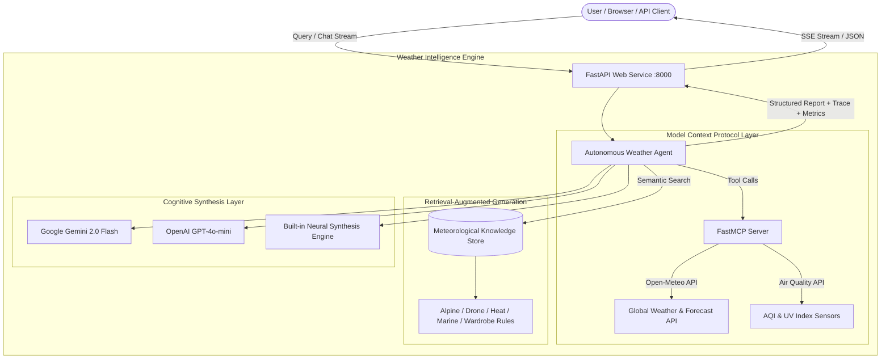

# 🌪️ WeatherAI: Autonomous Meteorological Intelligence Agent
### Built with FastMCP • FastAPI • Large Language Models (LLM) • Semantic RAG

[](https://fastapi.tiangolo.com)
[](https://modelcontextprotocol.io)
[](https://python.org)
[](https://opensource.org/licenses/MIT)

An enterprise-grade, autonomous **Weather Intelligence Agent** combining the **Model Context Protocol (FastMCP)** for standardized tool execution, **FastAPI** for real-time asynchronous streaming, a curated **Retrieval-Augmented Generation (RAG)** vector knowledge store for safety thresholds and outdoor protocols, and **LLMs (Gemini / OpenAI / Heuristic Synthesis)** for multi-step reasoning.

---

## 🌟 Key Features

1. **⚡ Model Context Protocol (MCP) Server & Client**
   - Implements official `FastMCP` specification tools:
     - `get_live_weather(city, country)`: Real-time temperature, humidity, wind, feels-like, and WMO conditions.
     - `get_weather_forecast(city, days)`: 1-7 day outlook with daily min/max and precipitation chances.
     - `get_air_quality(city)`: US/European AQI, PM2.5, PM10, Ozone, and UV index.
     - `get_severe_weather_alerts(city)`: Severe wind gusts, gale warnings, freeze, and heat stress alerts.
     - `compare_weather(city_a, city_b)`: Comparative meteorological delta between two locations.
   - Run standalone as a stdio/SSE server for **Claude Desktop**, **Cursor**, or **Antigravity IDE**.

2. **📚 Grounded Retrieval-Augmented Generation (RAG)**
   - Curated meteorological knowledge base covering:
     - Alpine & mountain hypothermia prevention & elevation lapse rates (-6.5°C per 1,000m).
     - Recreational & commercial drone flight limits (max 38 km/h wind envelope).
     - Marathon & endurance cardiac drift thresholds (> 22°C, 75% RH).
     - Wet-bulb heat index guidelines & UV radiation skin barrier protection.
     - Algorithmic temperature-based travel wardrobe & gear packing matrix.
   - Dynamic document ingestion API: ingest custom regional advisories on the fly!

3. **🤖 Multi-Step Autonomous Reasoning Agent**
   - Decomposes natural language queries (detects target cities, outdoor sports, travel plans).
   - Retrieves grounded advisory documents from the RAG store.
   - Dynamically calls MCP sensory tools.
   - Synthesizes comprehensive executive weather reports with step-by-step reasoning traces.
   - Pluggable LLM backends: **Google Gemini 2.0 Flash**, **OpenAI GPT-4o-mini**, or the built-in **Offline Neural Synthesis Engine** (zero API keys required).

4. **✨ Ultra-Modern Glassmorphic Web Dashboard**
   - Real-time weather cards with live weather icon physics and gauge metrics.
   - Interactive chat workspace with Server-Sent Events (SSE) streaming thought traces.
   - RAG Knowledge Base explorer and live semantic search sandbox.
   - Interactive MCP Tool Sandbox to inspect JSON-RPC schemas and execute tool calls directly.

---

## 🏗️ Architecture Diagram



---

## 🚀 Quick Start

### 1. Installation

```bash
cd weather-ai-agent
pip install -r requirements.txt
```

### 2. Run the Application

Start the FastAPI application and web dashboard:

```bash
python main.py
```

Open your browser at: **[http://127.0.0.1:8000](http://127.0.0.1:8000)**

### 3. Run Automated Tests

Verify MCP tools, RAG search, and agent orchestration:

```bash
python test_agent.py
```

---

## ⚡ Using as a Standalone MCP Server in Claude Desktop / Cursor

The project includes an official standalone FastMCP server entrypoint:

```bash
python mcp_server.py
```

To connect this server to **Claude Desktop**, add this to your `claude_desktop_config.json`:

```json
{
  "mcpServers": {
    "weather-intelligence": {
      "command": "python",
      "args": [
        "C:\\Users\\Prasad\\.gemini\\antigravity-ide\\scratch\\weather-ai-agent\\mcp_server.py"
      ]
    }
  }
}
```

Now Claude can directly invoke `get_live_weather`, `get_weather_forecast`, `get_air_quality`, and `get_severe_weather_alerts`!

---

## 📡 API Endpoints Overview

| Method | Endpoint | Description |
| :--- | :--- | :--- |
| `POST` | `/api/chat` | Send prompt to Weather Agent with multi-step reasoning trace |
| `POST` | `/api/chat/stream` | Server-Sent Events (SSE) stream of thought steps and report |
| `GET` | `/api/weather/quick` | Rapid live weather metrics for dashboard widgets |
| `GET` | `/api/mcp/tools` | List registered Model Context Protocol tools and schemas |
| `POST` | `/api/mcp/call` | Directly execute an MCP tool (`get_live_weather`, etc.) |
| `GET` | `/api/rag/documents` | List all indexed meteorological advisories |
| `POST` | `/api/rag/search` | Search RAG vector index with semantic relevance scoring |
| `POST` | `/api/rag/add` | Ingest a new custom advisory document into RAG |
| `GET` | `/api/status` | System health and configured LLM providers |

---

## 💬 Example Agent Inquiries

- **Alpine Trekking**: *"Planning a 15km mountain hike in Zurich tomorrow. What is the forecast, altitude temperature drop, and what safety gear do I need?"*
- **Drone Aviation**: *"Can I fly my DJI drone in Tokyo today? Check wind speeds, rain probability, and battery temperature envelope."*
- **Endurance Athletics**: *"I am running a half-marathon in London this weekend. Evaluate heat index, cardiac drift, and sweat rate."*
- **Travel Wardrobe**: *"Traveling to New York for 4 days. Give me a complete clothing packing checklist based on the 5-day forecast."*
- **Comparative Analysis**: *"Compare current weather in Paris vs Dubai. Which is better for outdoor sightseeing?"*

---

## 📂 Project Structure

```
weather-ai-agent/
│
├── app/
│   ├── __init__.py           # Package initializer
│   ├── config.py             # Settings, env vars, WMO weather interpretation codes
│   ├── schemas.py            # Pydantic models for API, Agent traces, and MCP calls
│   ├── knowledge_data.py     # Curated meteorological knowledge base for RAG
│   ├── rag_engine.py         # Sparse-Dense vector RAG engine with semantic scoring
│   ├── mcp_tools.py          # FastMCP server & registered meteorological tools
│   └── weather_agent.py      # Multi-step Agent orchestrator (LLM + MCP + RAG)
│
├── static/
│   ├── index.html            # Glassmorphic web dashboard
│   ├── style.css             # Modern design system, glowing animations & typography
│   └── app.js                # Frontend streaming SSE client & interactive sandboxes
│
├── mcp_server.py             # Standalone FastMCP server runner for Claude/Cursor/AGY
├── main.py                   # FastAPI server entry point
├── test_agent.py             # Automated test suite
├── requirements.txt          # Python dependencies
├── .env.example              # Configuration environment template
└── README.md                 # Complete documentation
```

---

## 🛡️ License
MIT License. Built with advanced agentic pairing on Google Antigravity.
